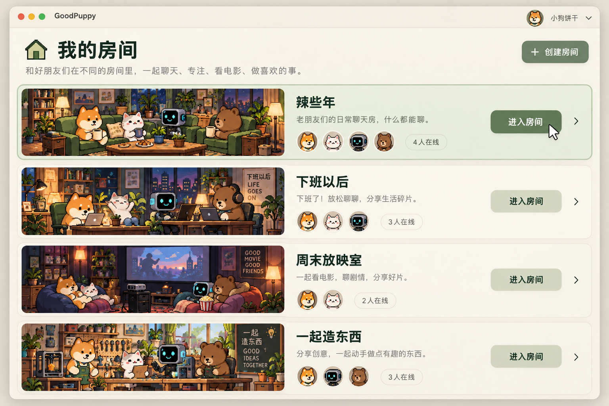
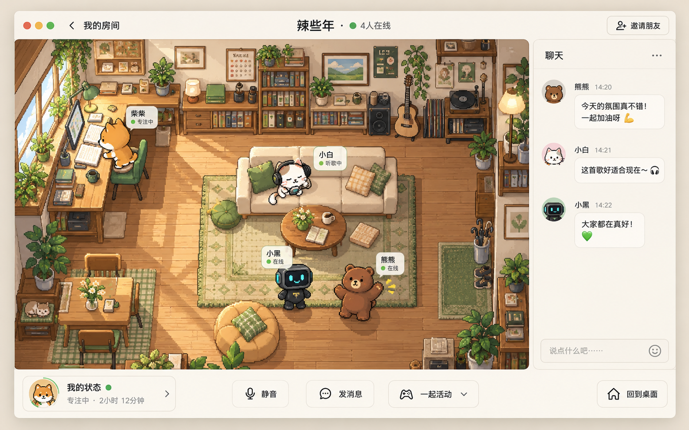
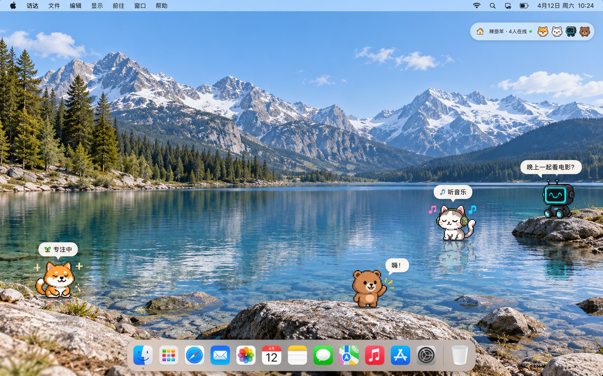
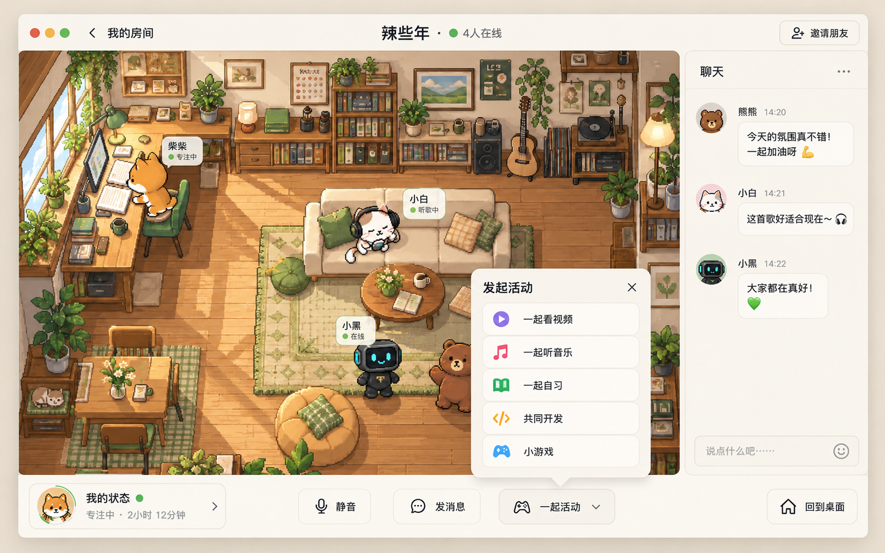
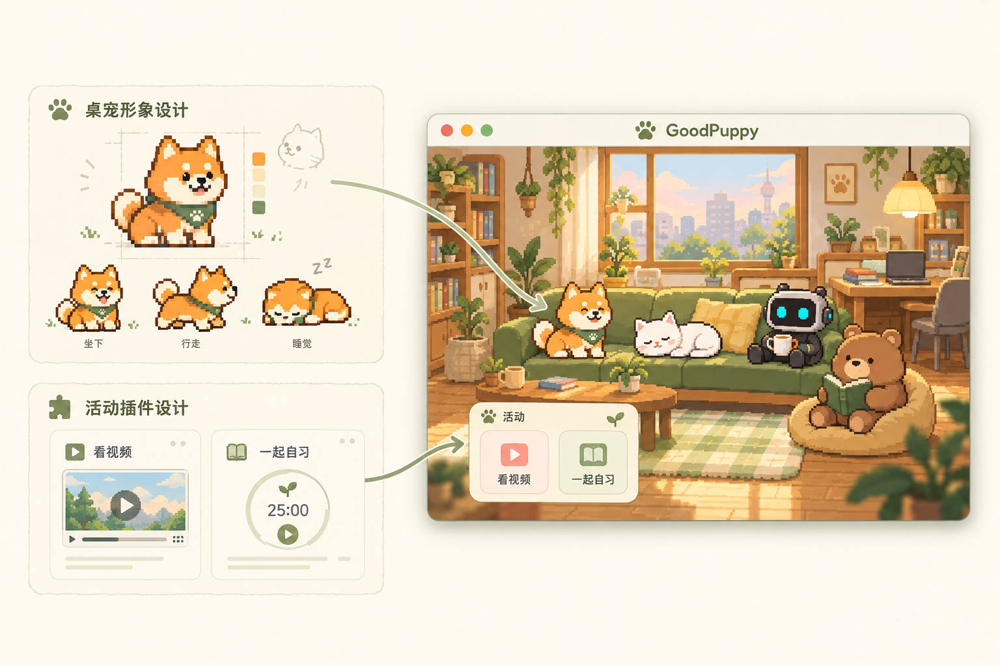
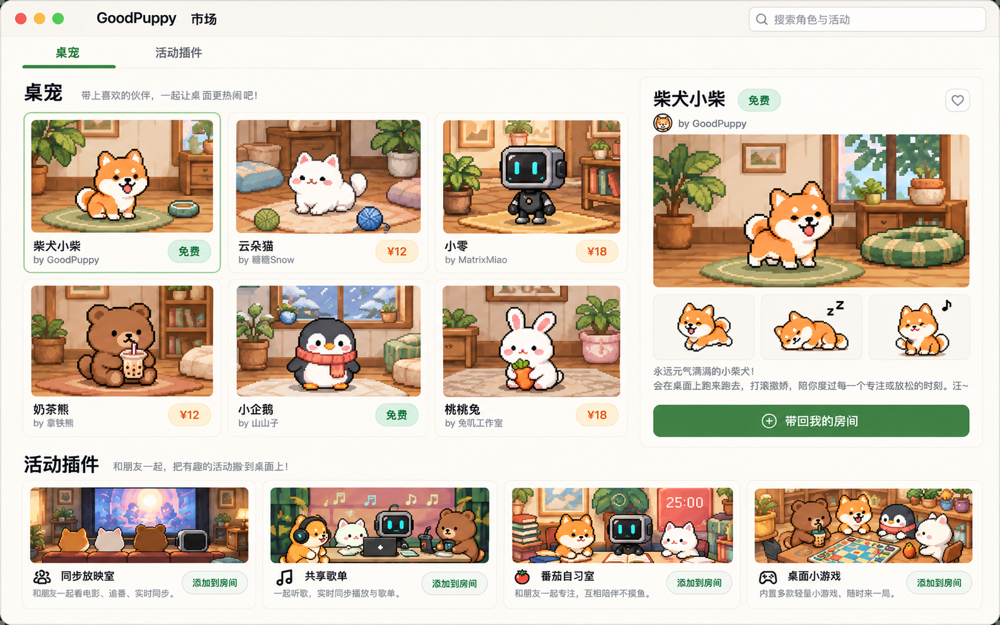

# 01 · 朋友在一起的线上空间

像一家青年旅社，

有很多个**房间**，每一个有一群朋友

---

# 02 · 房间

一个房间，一小群熟悉的人。

聊天、陪伴和活动，都围绕这个房间展开。

---

# 03 · 桌宠

桌宠是你在房间里的化身，可以呈现状态、传递互动

进入一个房间，可以让房间中的朋友出现在你的桌面上

---

# 04 · 活动

在同一个房间中，可以一起看视频、听音乐、自习、开发、玩游戏。

---

# 05 · 开发者生态

创作桌宠，赋予角色不同的形象与动作。  
开发活动插件，让房间拥有新的玩法。

---

# 06 · 市场与商业化

桌宠市场：发现与购买角色、皮肤和动作。  
插件市场：为房间添加活动与玩法。

创作者获得收益，平台通过交易分成持续运营。

