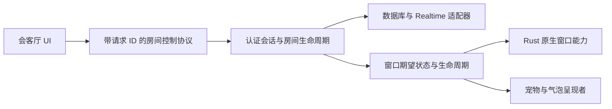

# GoodPuppy 项目诊断与可持续开发优化清单

> 本文保留诊断时的证据快照，不表示问题仍全部存在；当前修复状态见 [修复进度](repair-progress.md)，实现约定以最新 ADR 为准。

- 日期：2026-10-01（北京时间）
- 范围：当前工作区，包括上一轮尚未提交的显隐修复；应用运行代码、Tauri 原生层、能力配置、真实 Supabase schema/RLS/grants/RPC/迁移/索引/publication、关键 ADR、构建和资产工具。
- 本轮产物：诊断报告。未修改业务代码、数据库、权限或用户数据；临时诊断测试已移除，上一轮修复保留。
- 方法：静态控制流检查、只读数据库元数据查询、依赖实际源码核对、Context7 官方资料、现有测试与 3 个临时受控时序测试。没有进行越权写入、生产压力测试或 Windows 实机验收，也没有逐帧视觉审查全部宠物素材。

## 判断

项目的主方向合理：原生 TypeScript、纯逻辑与副作用分离、单一房间协调者、哑呈现者、Rust 薄层，以及独立动画状态机都值得保留。复杂度主要积聚在**异步操作的完成边界、状态所有权、跨窗口协议和资源销毁**，不是缺少框架；大规模换框架会增加迁移风险而不自动解决这些问题。

本次桌宠显隐 bug 是这一类问题的具体表现：调用顺序不等于完成顺序，前端状态与原生实际状态没有统一契约。现有纯函数测试不少，但关键编排链路依靠全局变量、void 异步调用、定时重发和隐含成功条件，导致局部代码正确却整体状态错误。

报告共有 **40 项**。P1 应优先处理：授权缺口、已复现的状态竞态、错误传播和关键验证/迁移能力；P2 是明确的功能风险或稳健性改善；P3 是维护与开发体验改善。这里不使用 P0，因为本轮没有证明实际数据泄露或已发生严重生产事故。

“已确认”表示代码/真实定义直接证明该性质，或已有确定性复现，不表示每项都已在桌面实机触发；“风险”表示存在可解释的失败顺序，仍需隔离环境或双平台实测。维护建议不冒充 bug，规模风险也不冒充当前性能瓶颈。

## 当前职责与推荐边界

这是目标边界，不是本轮已经实现的结构。业务会话仍留在前端；Rust 保存原生资源、返回真实执行结果，呈现者不管理认证或房间订阅。状态广播与请求结果分开，房间/窗口实例带版本，任何迟到结果只能更新其所属的有效会话。

## 完整清单索引

| 编号 | 优先级 | 优化项 | 证据级别 |
|---|---|---|---|
| 01 | P1 | [房间成员写入和邀请缺少完整授权](#item-01) | 数据库定义已确认 |
| 02 | P1 | [Realtime Presence/Broadcast 未使用私有频道](#item-02) | 代码与 SDK 默认值已确认；服务设置未核验 |
| 03 | P1 | [进入、切换、退出房间没有统一并发边界](#item-03) | 受控时序测试已复现 |
| 04 | P1 | [注销和认证失效没有完整停止宠物会话](#item-04) | 静态控制流已确认；身份残留测试已确认 |
| 05 | P1 | [房间请求回执没有请求 ID、目标校验和超时](#item-05) | 静态控制流已确认 |
| 06 | P1 | [桥接层把失败伪装成成功](#item-06) | 静态控制流已确认 |
| 07 | P1 | [远程宠物的创建、退场与清理可能相互覆盖](#item-07) | 静态时序风险，未实机复现 |
| 08 | P1 | [原生注册表按 label 保存，但销毁后没有完整清理](#item-08) | 静态控制流已确认 |
| 09 | P2 | [历史加载与实时订阅之间存在消息缺口或覆盖](#item-09) | 静态时序风险 |
| 10 | P2 | [发送消息回环缺少关联和重复提交保护](#item-10) | 静态控制流已确认 |
| 11 | P2 | [事件监听注册与取消的接口隐藏异步时序](#item-11) | 静态控制流已确认 |
| 12 | P2 | [固定五次重发不能代替窗口就绪协议](#item-12) | 静态时序风险 |
| 13 | P2 | [“房间就绪”实际早于网络就绪，失败结果又被吞掉](#item-13) | 静态控制流已确认 |
| 14 | P2 | [退出依赖网络完成，在线写入可迟到覆盖退出](#item-14) | 静态控制流已确认 |
| 15 | P2 | [新的显隐队列还不是完整的房间生命周期控制器](#item-15) | 本轮已修复部分；剩余静态风险 |
| 16 | P2 | [认证刷新事件引起全部订阅重建](#item-16) | 静态控制流已确认 |
| 17 | P2 | [会客厅异步加载没有账号和请求版本保护](#item-17) | 静态时序风险 |
| 18 | P2 | [Realtime 刷新风暴和在线状态过期不主动更新](#item-18) | 静态成本与刷新逻辑已确认 |
| 19 | P2 | [通知窗口调度缺少取消、失败回收和队列上限](#item-19) | 静态时序风险 |
| 20 | P2 | [屏幕“可用区”接口实际返回整屏，坐标语义不统一](#item-20) | 静态实现已确认 |
| 21 | P2 | [原生命令的成功只表示任务入队，未表示实际完成](#item-21) | 静态控制流已确认 |
| 22 | P2 | [Windows 气泡父子语义与文档不一致](#item-22) | 代码缺失已确认；Windows 效果待实机 |
| 23 | P2 | [Windows 会客厅调用了未授权的窗口 API](#item-23) | 配置与调用对照已确认 |
| 24 | P2 | [光标采样和拖动状态缺少负载及失败保护](#item-24) | 静态运行成本与恢复缺口 |
| 25 | P2 | [创建房间与创建成员不是一个事务](#item-25) | 静态控制流已确认 |
| 26 | P1 | [数据库不能可靠从仓库重建](#item-26) | 本地与服务器迁移历史对照已确认 |
| 27 | P2 | [常用查询缺少匹配索引](#item-27) | 真实索引定义已确认 |
| 28 | P2 | [公开身份字段可由本人任意修改](#item-28) | 真实列权限已确认 |
| 29 | P2 | [聊天分页不是完整游标，长期打开会无限累积](#item-29) | 静态算法已确认 |
| 30 | P2 | [皮肤、偏好和气泡关闭状态的作用域不清](#item-30) | 静态数据来源已确认 |
| 31 | P2 | [角色打包、注册和异步 manifest 加载没有统一契约](#item-31) | 静态资源路径和缓存已确认 |
| 32 | P2 | [缺少可持久化、可关联的跨窗口诊断](#item-32) | 日志实现已确认 |
| 33 | P2 | [会客厅全局状态和副作用过于集中](#item-33) | 结构已确认 |
| 34 | P1 | [验证体系覆盖函数，但缺少生命周期和双平台门禁](#item-34) | 测试范围与 CI 文件已确认 |
| 35 | P3 | [旧入口和历史文档仍被当作现状指引](#item-35) | 代码与文档对照已确认 |
| 36 | P2 | [原生命令没有按窗口角色维护调用契约](#item-36) | 配置与接口已确认 |
| 37 | P3 | [多个弹层缺少统一焦点和生命周期管理](#item-37) | 交互实现已确认 |
| 38 | P2 | [后台、暂停和退出语义没有统一产品契约](#item-38) | 计时器与产品行为代码已确认 |
| 39 | P2 | [数据库 RPC 的并发行为缺少锁和幂等定义](#item-39) | 真实函数定义显示风险；并发事务未复现 |
| 40 | P3 | [开发、发布和资源工具缺少统一可重复入口](#item-40) | 工程配置与工具检查已确认 |

## 逐项诊断与验收要求

### 01 · P1 · 房间成员写入和邀请缺少完整授权

**证据级别：**数据库定义已确认。

**位置：**[supabase/migrations/20260606135355_harden_client_rls_boundaries.sql](/Users/nanshine/PlayGround/GoodPuppy/supabase/migrations/20260606135355_harden_client_rls_boundaries.sql:146)。

**问题与影响：**真实 room_members_insert 仅要求 user_id = auth.uid()，authenticated 对 room_id/user_id 有 INSERT 权限，因此“本人加入”没有同时校验“允许加入哪个房间”。connection_requests_insert 不校验邀请者属于 room_id；private.accept_connection 在已有房间分支直接将双方加入，也没有补做此校验。知道目标房间 UUID 的客户端存在绕过邀请码/成员授权的路径。未执行越权写入。

**建议：**把创建房间及加入成员、邀请码加入、邀请发出/接受收敛成有明确授权检查的事务 RPC，限制直接插入成员；接受邀请时重新校验邀请者资格，不能仅信任请求创建时的状态。

**验收：**在隔离测试库分别验证本人合法建房、合法邀请、猜测 UUID 加入、非成员邀请、邀请者退出后接受、跨账号操作。

### 02 · P1 · Realtime Presence/Broadcast 未使用私有频道

**证据级别：**代码与 SDK 默认值已确认；服务设置未核验。

**位置：**[src/windows/pet/presence.ts](/Users/nanshine/PlayGround/GoodPuppy/src/windows/pet/presence.ts:101)；[src/windows/pet/interactions.ts](/Users/nanshine/PlayGround/GoodPuppy/src/windows/pet/interactions.ts:29)。

**问题与影响：**两个频道均未设置 private: true，已安装 SDK 默认 private 为 false，客户端没有建立房间成员授权边界。互动 payload 只检查字符串，actorId、targetId 不绑定真实发送者；Presence key 也由客户端声明。普通业务表 RLS 并不自动保护公共 Broadcast/Presence。数据库 realtime.messages 开启了 RLS，但只读查询未发现对应策略；项目是否禁用公共频道尚未核验，因此不能宣称已完成外部攻击复现。

**建议：**使用私有频道及按 room membership/topic 的 Realtime 策略，核验服务端公共频道设置；明确互动身份可信程度、合法动作和接收频率。必要时通过受信任服务广播。

**验收：**成员/非成员/匿名会话的订阅、track、send 都要做允许与拒绝测试，并验证伪造 actorId 不会产生可信业务行为。

### 03 · P1 · 进入、切换、退出房间没有统一并发边界

**证据级别：**受控时序测试已复现。

**位置：**[src/windows/pet/roomManager.ts](/Users/nanshine/PlayGround/GoodPuppy/src/windows/pet/roomManager.ts:108)；[src/windows/pet/roomManager.ts](/Users/nanshine/PlayGround/GoodPuppy/src/windows/pet/roomManager.ts:184)。

**问题与影响：**恢复和切换都直接启动异步加载，显隐队列不覆盖这些操作。已复现：进入 A 的历史请求挂起时退出，旧请求完成后仍 join A、写 online；A 未完成时切到 B，再放行 A，currentRoomId 仍为 B，但最后订阅却回到 A。

**建议：**引入房间会话对象和递增版本，串行处理明确用户操作；每个异步结果/订阅回调校验捕获的版本。失效操作释放自己的资源，不得修改新会话。

**验收：**持续回归 A→退出、A→B、恢复→手动进入、快速 A→B→A、旧订阅回调迟到及网络失败的所有顺序。

### 04 · P1 · 注销和认证失效没有完整停止宠物会话

**证据级别：**静态控制流已确认；身份残留测试已确认。

**位置：**[src/windows/pet/selfMain.ts](/Users/nanshine/PlayGround/GoodPuppy/src/windows/pet/selfMain.ts:20)；[src-tauri/src/lib.rs](/Users/nanshine/PlayGround/GoodPuppy/src-tauri/src/lib.rs:129)；[src/windows/lounge/lounge.ts](/Users/nanshine/PlayGround/GoodPuppy/src/windows/lounge/lounge.ts:444)。

**问题与影响：**auth-cleared 在 Rust 仅隐藏 main，并没有让 roomManager 重置 selfAuthId、client、hasStartedPetApp、状态及订阅。显式注销先退出房间有一定保护，但 signOut 的 error 未检查，意外 SIGNED_OUT 也只更新会客厅 UI。测试确认 exitCurrentRoom 不清身份；迟到的进入/显隐任务仍可能在注销后运行。

**建议：**建立独立 stopSession/resetSession，认证用户变更和失效都调用；先使旧会话版本失效，再清计时器、频道和窗口。只有同一已认证会话可以显示宠物。

**验收：**房间加载中注销、断网注销失败、会话失效、A 用户退出后 B 用户登录，均不能留下 A 的订阅、窗口或缓存。

### 05 · P1 · 房间请求回执没有请求 ID、目标校验和超时

**证据级别：**静态控制流已确认。

**位置：**[src/windows/lounge/lounge-main.ts](/Users/nanshine/PlayGround/GoodPuppy/src/windows/lounge/lounge-main.ts:124)；[src/windows/lounge/lounge-main.ts](/Users/nanshine/PlayGround/GoodPuppy/src/windows/lounge/lounge-main.ts:188)。

**问题与影响：**进入请求只保存一个 resolve，任何非空 active-room-changed 都会确认进入，没有校验是请求目标房间。启动恢复通知、request-active-room 回复都可能被误当操作成功；失败返回空房间时 pendingEnterResolve 永不完成。退出同样没有超时，能连带卡住注销和永久退房。

**建议：**区分状态广播与操作回复，使用 requestId、目标 roomId、success/error，并设置可恢复超时；先注册回复监听再发请求，关闭/注销时取消 pending。

**验收：**错误目标回复不能确认；重复/迟到回复忽略；窗口未就绪、发送失败、服务器拒绝和超时后按钮恢复可用。

### 06 · P1 · 桥接层把失败伪装成成功

**证据级别：**静态控制流已确认。

**位置：**[src/shared/bridge.ts](/Users/nanshine/PlayGround/GoodPuppy/src/shared/bridge.ts:170)；[src/shared/bridge.ts](/Users/nanshine/PlayGround/GoodPuppy/src/shared/bridge.ts:188)。

**问题与影响：**spawn/close/emit 等方法 catch 后只 console.error，使 Promise 正常 resolve。协调者随后把 selfBubbleSpawned 设为 true，或保留远程 entry，虽然原生创建可能已失败；toast 也会占用槽位。上一轮显隐修复的失败重试测试使用可 reject 的 mock，真实 bridge 不满足这个前提。

**建议：**业务必须知晓的命令传播错误或返回明确 Result；只在调用边界记录一次。窗口创建成功、原生配置完成、前端就绪分别建模，失败回滚 entry/slot。

**验收：**通过真实 bridge 的 invoke mock 注入拒绝，确认标记未设为成功、槽位释放、后续重试能实际创建窗口。

### 07 · P1 · 远程宠物的创建、退场与清理可能相互覆盖

**证据级别：**静态时序风险，未实机复现。

**位置：**[src/windows/pet/roomCoordinator.ts](/Users/nanshine/PlayGround/GoodPuppy/src/windows/pet/roomCoordinator.ts:197)；[src/windows/pet/roomCoordinator.ts](/Users/nanshine/PlayGround/GoodPuppy/src/windows/pet/roomCoordinator.ts:395)。

**问题与影响：**applyPresence 被 void 启动，没有串行/版本保护，多次 presence sync 可并行布局和创建；await desiredLayout/spawn 后未复查房间及 entry 是否仍有效。退出清空 remotes 时，较早的创建任务仍可能继续生成气泡；退场 close 与同 label 重新上线创建也没有等待销毁完成。

**建议：**每个成员建立 desired/pending/ready/leaving 生命周期，并绑定 room epoch 和窗口 instanceId；对 diff 合并调度，实际完成后对齐最新 desired 集合。

**验收：**延迟 spawn 后退出、离线立即重上线、同一用户跨房间、重复 sync、创建一半失败，不出现幽灵/缺失窗口。

### 08 · P1 · 原生注册表按 label 保存，但销毁后没有完整清理

**证据级别：**静态控制流已确认。

**位置：**[src-tauri/src/bubbles.rs](/Users/nanshine/PlayGround/GoodPuppy/src-tauri/src/bubbles.rs:34)；[src-tauri/src/bubbles.rs](/Users/nanshine/PlayGround/GoodPuppy/src-tauri/src/bubbles.rs:64)；[src-tauri/src/cursor.rs](/Users/nanshine/PlayGround/GoodPuppy/src-tauri/src/cursor.rs:121)；[src-tauri/src/commands.rs](/Users/nanshine/PlayGround/GoodPuppy/src-tauri/src/commands.rs:114)。

**问题与影响：**BubbleRegistry.listening_parents 永久保留已监听 label，远程宠物销毁重建使用相同 label 后，ensure_parent_follow_listener 会直接返回，新的父窗口没有 Moved 监听。HitShapes 和 cursor last_ignore 也没有随销毁清除，重建可继承旧掩模/穿透缓存；初次设置可能因为缓存相同被跳过。

**建议：**统一窗口注销，清理 shapes、ignore cache、parent listener 标记、children 和 offsets；用窗口实例而非仅 label 标识生命周期，缓存写入要依据命令成功结果。

**验收：**同一成员反复上线/离线后，Windows 跟随与 macOS 拖动跟随正常，首次点击不会落到旧形状或错误穿透状态。

### 09 · P2 · 历史加载与实时订阅之间存在消息缺口或覆盖

**证据级别：**静态时序风险。

**位置：**[src/windows/pet/roomManager.ts](/Users/nanshine/PlayGround/GoodPuppy/src/windows/pet/roomManager.ts:114)；[src/windows/lounge/views/chat-history-dialog.ts](/Users/nanshine/PlayGround/GoodPuppy/src/windows/lounge/views/chat-history-dialog.ts:198)。

**问题与影响：**桌宠先查历史再注册订阅，中间消息可能遗漏；聊天记录先开启历史请求并订阅，但 loadInitial 返回时直接 messages = page.messages，可能覆盖请求期间刚 append 的实时消息，seenIds 又已记录其 ID，后续重放也可能被去重。

**建议：**先等待订阅就绪并缓冲事件，再加载快照，按 ID 合并且按稳定顺序排序；重连后从最后游标补拉，不能只依赖事件一定到达。

**验收：**历史请求开始到完成之间插入消息、重连补发、自己消息的本地与实时重复，每条最终只出现一次且不丢失。

### 10 · P2 · 发送消息回环缺少关联和重复提交保护

**证据级别：**静态控制流已确认。

**位置：**[src/windows/pet/bubbleMain.ts](/Users/nanshine/PlayGround/GoodPuppy/src/windows/pet/bubbleMain.ts:59)；[src/windows/pet/composeStick.ts](/Users/nanshine/PlayGround/GoodPuppy/src/windows/pet/composeStick.ts:38)；[src/windows/pet/petWindowEvents.ts](/Users/nanshine/PlayGround/GoodPuppy/src/windows/pet/petWindowEvents.ts:62)。

**问题与影响：**所有提交监听同一个 SELF_COMPOSE_RESULT，没有 requestId；表单发送中仍可再次提交，两个 Promise 可能被同一回复解决。监听尚未安装时就 emit，请求丢失后没有超时；发送完成时读取当前房间，输入条保留内容也可能跨房间提交。

**建议：**提交携带 requestId、room/session version；发送中禁用或去重；单一响应路由器、超时及取消；切房间清理编辑上下文。数据库需要时增加幂等键。

**验收：**双击发送、第一条失败第二条成功、切房间/注销途中回复、主窗口未响应，均不串回复、不重复落库。

### 11 · P2 · 事件监听注册与取消的接口隐藏异步时序

**证据级别：**静态控制流已确认。

**位置：**[src/shared/bridge.ts](/Users/nanshine/PlayGround/GoodPuppy/src/shared/bridge.ts:244)；[src/shared/bridge.ts](/Users/nanshine/PlayGround/GoodPuppy/src/shared/bridge.ts:252)。

**问题与影响：**onAppEvent 立即返回一个取消函数，但真实 appWindow.listen 尚未 resolve；先调用取消再注册完成，监听仍会遗留。监听注册失败也没有 catch。调用方无法 await 监听就绪，toast-ready 和 compose-submit 可以早于接收监听安装。

**建议：**事件 API 暴露 ready/dispose，或直接返回 Promise<Unlisten>；记录 cancelled 标志，注册完成后若已取消立即解除，统一处理注册错误。

**验收：**注册 Promise 延迟、注册前取消、注册拒绝、收到结果前注销和重建都不泄漏监听。

### 12 · P2 · 固定五次重发不能代替窗口就绪协议

**证据级别：**静态时序风险。

**位置：**[src/windows/pet/roomCoordinator.ts](/Users/nanshine/PlayGround/GoodPuppy/src/windows/pet/roomCoordinator.ts:272)；[src/windows/pet/roomCoordinator.ts](/Users/nanshine/PlayGround/GoodPuppy/src/windows/pet/roomCoordinator.ts:113)。

**问题与影响：**5×120ms 的重发只覆盖假定的启动速度。慢设备超过窗口期可丢首帧；重试捕获旧 info/history，在新状态和消息到达后又覆盖回旧值。远程 history 为空时还跳过发送，不能作为完整快照协议。toast 已有 ready 事件，可作为局部经验但其监听仍有就绪竞态。

**建议：**每个呈现者发 ready(instanceId)，协调者发送最新完整快照和递增 revision，确认后再增量更新；重试应读取最新状态且可取消。

**验收：**窗口延迟超过一秒、新消息发生在初始化期间、旧窗口 ready 迟到，不会回退身份、状态或消息。

### 13 · P2 · “房间就绪”实际早于网络就绪，失败结果又被吞掉

**证据级别：**静态控制流已确认。

**位置：**[src/windows/pet/roomManager.ts](/Users/nanshine/PlayGround/GoodPuppy/src/windows/pet/roomManager.ts:122)；[src/windows/pet/interactions.ts](/Users/nanshine/PlayGround/GoodPuppy/src/windows/pet/interactions.ts:37)；[src/windows/pet/presence.ts](/Users/nanshine/PlayGround/GoodPuppy/src/windows/pet/presence.ts:107)。

**问题与影响：**activateRoom 先赋 currentRoomId、调用 onRoomReady，之后才配置 Presence 和互动；subscribe 返回 RealtimeChannel，await 它并不等待 SUBSCRIBED。switchRoom 捕获错误后正常 resolve，调用者无法分辨失败、忽略或成功，界面容易出现“已进入但没有在线连接”。

**建议：**区分 entering/active/degraded/leaving/idle；网络准备等待 SUBSCRIBED、track 结果和超时，UI ready 与房间连接 ready 使用不同名称；返回明确结果。

**验收：**订阅超时、频道拒绝、track 失败时 UI 表达真实状态，不能回报连接成功；允许设计明确的离线降级。

### 14 · P2 · 退出依赖网络完成，在线写入可迟到覆盖退出

**证据级别：**静态控制流已确认。

**位置：**[src/windows/pet/roomManager.ts](/Users/nanshine/PlayGround/GoodPuppy/src/windows/pet/roomManager.ts:196)；[src/windows/pet/roomManager.ts](/Users/nanshine/PlayGround/GoodPuppy/src/windows/pet/roomManager.ts:67)。

**问题与影响：**退出串行 await unsubscribe、数据库清理、取消消息订阅，直到最后才 currentRoomId = null 和清窗口；任一步抛错就阻断剩余清理。进入时在线 upsert 是 fire-and-forget，可在退出离线 update 后才完成，把数据库重新写成在线。

**建议：**先使本地会话失效并完成本地收尾；远端清理采用 allSettled/finally 和限时重试。presence 写入串行化并携带会话语义，服务端 last_seen 作为租约而非唯一正确性保障。

**验收：**每一步注入失败，宠物和远程窗口仍可收起、计时器停止；迟到 upsert 不得覆盖较新的退出状态。

### 15 · P2 · 新的显隐队列还不是完整的房间生命周期控制器

**证据级别：**本轮已修复部分；剩余静态风险。

**位置：**[src/windows/pet/roomVisibility.ts](/Users/nanshine/PlayGround/GoodPuppy/src/windows/pet/roomVisibility.ts:2)；[src/windows/pet/renderer.ts](/Users/nanshine/PlayGround/GoodPuppy/src/windows/pet/renderer.ts:229)。

**问题与影响：**本轮修复已阻止无房间启动创建气泡，并在准备后重读 roomId，但队列只覆盖窗口准备/显隐，不能防底层进入请求在退出后重新订阅。prepare 或 setVisible 失败会跳过 notify，使会客厅请求悬挂；快速 A→B 时还缺少具体 room/version 对齐。原生创建命令也只是排入主线程，await 不保证其配置完成。

**建议：**保留小控制器，将它作为房间会话的 effect 执行器，绑定会话版本与命令完成回执；明确失败时的可见性和通知结果。不把业务状态搬进 Rust。

**验收：**使用真实 bridge 行为注入准备/显示失败；验收注销与切房间后不存在旧版本 effect，失败回复能解除会客厅等待。

### 16 · P2 · 认证刷新事件引起全部订阅重建

**证据级别：**静态控制流已确认。

**位置：**[src/windows/lounge/lounge-main.ts](/Users/nanshine/PlayGround/GoodPuppy/src/windows/lounge/lounge-main.ts:166)；[src/windows/lounge/lounge.ts](/Users/nanshine/PlayGround/GoodPuppy/src/windows/lounge/lounge.ts:1383)。

**问题与影响：**除 INITIAL_SESSION 外，每个 auth 事件都会 updateLoungePanelAuth；只要有 selfAuthId 就重建全部五个频道、重载面板、初始化通知器。TOKEN_REFRESHED/USER_UPDATED 并不代表用户身份切换，反复 remove/recreate 会产生事件间隙和多余查询。

**建议：**分别处理身份变化、令牌更新和资料变化；同一 userId 的认证刷新只更新必要状态，频道重连交给 SDK 或明确管理器；旧用户资源销毁应使用捕获的 client。

**验收：**令牌刷新不改变频道实例数、不重复注册通知；跨账号时一次性清旧资源再初始化新资源。

### 17 · P2 · 会客厅异步加载没有账号和请求版本保护

**证据级别：**静态时序风险。

**位置：**[src/windows/lounge/lounge.ts](/Users/nanshine/PlayGround/GoodPuppy/src/windows/lounge/lounge.ts:623)；[src/windows/lounge/lounge.ts](/Users/nanshine/PlayGround/GoodPuppy/src/windows/lounge/lounge.ts:1383)。

**问题与影响：**loadPanelData 多次 await 后使用可变的全局 selfAuthId/client，把结果直接赋给 rooms/profile/requests。旧账号或旧刷新请求可在注销/切换后返回，重新填充 UI；不同阶段甚至可能混用不同账号上下文。旧请求失败也可能把新页面覆盖成错误态。

**建议：**捕获 authEpoch、client、userId 和 loadRevision，所有写 UI 的结果校验仍有效；支持 AbortSignal，状态提交采用一次快照更新。

**验收：**A 加载挂起→注销→B 登录→A 返回，以及旧错误晚于新成功，不得出现跨账号数据或错误覆盖。

### 18 · P2 · Realtime 刷新风暴和在线状态过期不主动更新

**证据级别：**静态成本与刷新逻辑已确认。

**位置：**[src/windows/lounge/lounge.ts](/Users/nanshine/PlayGround/GoodPuppy/src/windows/lounge/lounge.ts:1132)；[src/windows/lounge/loungeViewModels.ts](/Users/nanshine/PlayGround/GoodPuppy/src/windows/lounge/loungeViewModels.ts:16)。

**问题与影响：**邀请、成员、profile、presence 变动基本都触发全量 loadPanelData，一次刷新通常 5 次查询，profile 初始化更多；心跳每分钟也触发这些操作。请求没有合并/去抖。离线阈值仅在 render 时计算，没有时钟驱动，某成员崩溃后若再无事件/刷新，UI 可持续显示旧在线状态。

**建议：**刷新任务合并、在途共享并保留一次 dirty rerun，优先局部更新；在线租约由统一时钟/可见时刷新计算，重连有补拉。

**验收：**多人连续心跳查询量有上界；无人产生事件时，超过租约阈值仍会及时转离线。

### 19 · P2 · 通知窗口调度缺少取消、失败回收和队列上限

**证据级别：**静态时序风险。

**位置：**[src/windows/lounge/onlineNotifier.ts](/Users/nanshine/PlayGround/GoodPuppy/src/windows/lounge/onlineNotifier.ts:148)；[src/windows/lounge/onlineNotifier.ts](/Users/nanshine/PlayGround/GoodPuppy/src/windows/lounge/onlineNotifier.ts:179)。

**问题与影响：**allocate 先占 slot 再 await 屏幕和 spawn；注销/dismissAll 可在这期间释放 slot，但旧 allocate 仍继续生成孤立 toast。spawn 错误被 bridge 吞掉，可永久占槽；没有 toast-ready 超时，queue 无上限，过期房间/用户提醒出队时也不重新校验。

**建议：**调度器绑定 auth generation，每个 pending task 可取消，失败/ready 超时释放 slot；设置队列上限、TTL、按房间合并和出队资格校验。

**验收：**注销时延迟创建、spawn 失败、ready 丢失和大量事件，窗口数/队列受控且不出现旧账号提醒。

### 20 · P2 · 屏幕“可用区”接口实际返回整屏，坐标语义不统一

**证据级别：**静态实现已确认。

**位置：**[src/shared/bridge.ts](/Users/nanshine/PlayGround/GoodPuppy/src/shared/bridge.ts:39)；[src/windows/pet/roomCoordinator.ts](/Users/nanshine/PlayGround/GoodPuppy/src/windows/pet/roomCoordinator.ts:86)。

**问题与影响：**getMonitorWorkArea 使用 monitor.position/size，未扣菜单栏、Dock/taskbar；getCursorMonitorWorkArea 才用 workArea。气泡用 main 所在屏而不是该宠物所在屏。混合 DPI 多屏将每块屏的全局坐标分别除 scale 的做法，需要核验与 Tauri LogicalPosition 的一致性；目前未实机复现混合 DPI 偏移。

**建议：**区分 monitorBounds/workArea，按目标宠物坐标找屏，统一逻辑/物理/内容/外框坐标类型与转换位置；混合 DPI 的全局坐标转换通过双平台实测固定契约。

**验收：**副屏负坐标、Dock 各边、Windows taskbar、100%/150% 混合缩放、显示器断开，均不会把宠物/气泡放进不可用区域。

### 21 · P2 · 原生命令的成功只表示任务入队，未表示实际完成

**证据级别：**静态控制流已确认。

**位置：**[src-tauri/src/commands.rs](/Users/nanshine/PlayGround/GoodPuppy/src-tauri/src/commands.rs:141)；[src-tauri/src/platform.rs](/Users/nanshine/PlayGround/GoodPuppy/src-tauri/src/platform.rs:54)。

**问题与影响：**run_on_main_thread 入队成功后命令返回 Ok，闭包内 show/destroy 结果多为 let _；guard_appkit 捕获异常后也仅日志。前端 await spawn/close 误以为配置/销毁已完成，接着发送消息或重建同 label，和本次 bug 的底层时序紧密相关。

**建议：**通过 oneshot/明确完成事件返回主线程操作实际结果；创建、配置、显示、销毁有真实完成边界。AppKit 异常转换成可诊断错误，不伪装成功。

**验收：**人工延迟主线程、show/destroy 失败/异常，调用方不能提前提交 ready 标记或创建冲突 label。

### 22 · P2 · Windows 气泡父子语义与文档不一致

**证据级别：**代码缺失已确认；Windows 效果待实机。

**位置：**[src-tauri/src/platform.rs](/Users/nanshine/PlayGround/GoodPuppy/src-tauri/src/platform.rs:138)；[src-tauri/src/bubbles.rs](/Users/nanshine/PlayGround/GoodPuppy/src-tauri/src/bubbles.rs:81)；[docs/adr/0016-气泡升级为独立子窗口.md](/Users/nanshine/PlayGround/GoodPuppy/docs/adr/0016-气泡升级为独立子窗口.md:1)。

**问题与影响：**非 macOS add_child_window 是空实现，Windows 仅监听 Moved 跟随，没有建立文档描述的 owner/set_parent 关系，也没有显式气泡显隐与父窗口绑定。位置跟随并不等于隐藏、最小化和层级随父窗口，退出后气泡可能残留的风险需实机核验。

**建议：**明确定义跨平台 owner、可见性、销毁契约；Windows 建立正确的 owner 或以窗口管理器显式同步显隐，保持 macOS panel 只隐藏不销毁的约束。

**验收：**Windows 首次进房、退出、注销、托盘开关、父窗口最小化与重新上线时，气泡跟随和显隐都一致。

### 23 · P2 · Windows 会客厅调用了未授权的窗口 API

**证据级别：**配置与调用对照已确认。

**位置：**[src/windows/lounge/lounge-main.ts](/Users/nanshine/PlayGround/GoodPuppy/src/windows/lounge/lounge-main.ts:25)；[src-tauri/capabilities/lounge.json](/Users/nanshine/PlayGround/GoodPuppy/src-tauri/capabilities/lounge.json:8)。

**问题与影响：**initWinTitlebar 调用 setSize、setMinSize、show，当前 lounge capability 不含对应权限；最小化按钮调用 minimize 也未授权。实际权限定义的 default 也不包含这些写操作，且 lounge 没引用 core:default。resize 的 catch 会掩盖部分失败，show 的拒绝会使后续初始化中断。

**建议：**对照每个窗口实际调用生成权限清单，按需补全并加入静态契约检查；不能用扩大到所有权限替代排查。

**验收：**Windows 标题栏缩放、最小化和初始化流程无 permission denied，失败时控制按钮仍可用。

### 24 · P2 · 光标采样和拖动状态缺少负载及失败保护

**证据级别：**静态运行成本与恢复缺口。

**位置：**[src-tauri/src/cursor.rs](/Users/nanshine/PlayGround/GoodPuppy/src-tauri/src/cursor.rs:138)；[src/windows/pet/petPresenter.ts](/Users/nanshine/PlayGround/GoodPuppy/src/windows/pet/petPresenter.ts:41)；[src/windows/pet/petPresenter.ts](/Users/nanshine/PlayGround/GoodPuppy/src/windows/pet/petPresenter.ts:148)。

**问题与影响：**原生每 16ms 向主线程排任务，没有显式“上一帧仍在途则合并”的控制，采样全部覆盖窗含隐藏窗，并持有 map 锁调用原生 API。前端每 120ms 重绘 GIF 掩模，即使与前次一致仍下发；原生命中与前端 hitSlop 不完全一致。拖动启动失败时没有统一 finally 复位 forceInteractive/isNativeDragging。

**建议：**先测采样延迟/CPU/IPC，再合并在途任务、跳过隐藏窗、缩短锁范围、仅发送变化掩模；拖动用明确 start/active/end/cancel，启动失败也恢复。

**验收：**1/10/30 只宠物下记录 CPU 和采样延迟；拖动拒绝、取消、切屏时不会保持整窗可交互或丢失命中。

### 25 · P2 · 创建房间与创建成员不是一个事务

**证据级别：**静态控制流已确认。

**位置：**[src/windows/lounge/lounge.ts](/Users/nanshine/PlayGround/GoodPuppy/src/windows/lounge/lounge.ts:793)。

**问题与影响：**先插 rooms 再插 room_members，第二步失败或客户端关闭后会留下创建者也无法按 rooms_select 查到的无成员房间。前端自己预生成 UUID 是为了绕开查询 RLS，但没有解决操作原子性。

**建议：**提供 create_room RPC，将建房、加入创建者和返回 ID 作为一次授权事务，并考虑请求幂等；与条目 01 同步收紧直接 member INSERT。

**验收：**第二步失败时没有 orphan room；同一请求重试不创建两个房间，合法创建者始终可以读取新房间。

### 26 · P1 · 数据库不能可靠从仓库重建

**证据级别：**本地与服务器迁移历史对照已确认。

**位置：**[docs/database.md](/Users/nanshine/PlayGround/GoodPuppy/docs/database.md:1)；[supabase/migrations/20260606135355_harden_client_rls_boundaries.sql](/Users/nanshine/PlayGround/GoodPuppy/supabase/migrations/20260606135355_harden_client_rls_boundaries.sql:55)。

**问题与影响：**本地只有 5 个迁移文件，服务器记录 11 个，缺初始 schema、presence 单行改造、leave_room、request room_id、匿名清理 FK/会话修订等文件；部分同功能迁移时间戳也不一致。get_pending_room_invitations 存在于真实函数中，但本地对应迁移没有同名历史记录，需确定是否通过直接 SQL 执行。

**建议：**只读导出并核对 schema、函数、RLS、grant、publication、cron；制定有审阅的基线/迁移历史修复方案，先证明空库可重建再继续数据库重构，不能随意重写已应用历史。

**验收：**从干净隔离库执行迁移，结构与预期一致，应用 smoke test 通过；schema diff 和迁移历史检查进入 CI。

### 27 · P2 · 常用查询缺少匹配索引

**证据级别：**真实索引定义已确认。

**位置：**[src/windows/lounge/chatHistory.ts](/Users/nanshine/PlayGround/GoodPuppy/src/windows/lounge/chatHistory.ts:126)；[src/windows/lounge/lounge.ts](/Users/nanshine/PlayGround/GoodPuppy/src/windows/lounge/lounge.ts:623)。

**问题与影响：**真实 messages、presence、connection_requests 仅各自主键索引；room_members 主键为 (room_id,user_id)。按 user_id 查我的房间、按 current_room_id 查 presence、按 room_id/kind/时间分页及收发 pending 邀请都没有专用匹配索引。当前数据量很小，尚不能宣称有可感知性能瓶颈。

**建议：**用真实查询 EXPLAIN 和模拟增长数据评估 user_id/room_id、消息复合游标索引、presence room 索引和邀请 partial index；按计划逐个添加。

**验收：**记录查询计划和耗时随数据增长变化，不以“加了索引”作为唯一验收。

### 28 · P2 · 公开身份字段可由本人任意修改

**证据级别：**真实列权限已确认。

**位置：**[docs/database.md](/Users/nanshine/PlayGround/GoodPuppy/docs/database.md:20)；[src/windows/lounge/loungeViewModels.ts](/Users/nanshine/PlayGround/GoodPuppy/src/windows/lounge/loungeViewModels.ts:11)。

**问题与影响：**profiles UPDATE 授权所有列，包括 gp_id、created_at、pet_id/skin；RLS 只限制自己的行。代码和文档却把 gp_id 视为数据库生成的稳定身份，皮肤/形象值也假定合法。唯一约束避免重复，但不能保证稳定性或资源值合法。

**建议：**明确字段可变性，将稳定身份/创建时间限制为不可修改；pet_id/skin 校验合法注册表或服务端允许值，UI 的前端验证不能替代数据库约束。

**验收：**直接 REST 尝试修改 gp_id/created_at 被拒绝，合法昵称和皮肤可修改，不会生成缺失资源路径。

### 29 · P2 · 聊天分页不是完整游标，长期打开会无限累积

**证据级别：**静态算法已确认。

**位置：**[src/windows/lounge/chatHistory.ts](/Users/nanshine/PlayGround/GoodPuppy/src/windows/lounge/chatHistory.ts:140)；[src/windows/lounge/views/chat-history-dialog.ts](/Users/nanshine/PlayGround/GoodPuppy/src/windows/lounge/views/chat-history-dialog.ts:179)。

**问题与影响：**排序使用 (created_at,id)，但下一页只携带 created_at 并使用严格 lt；时间相同且跨页边界的消息会漏。appendMessage 按到达顺序追加，异步解析发送者可能使顺序反转。messages/seenIds/DOM 不设上限，每次 loadOlder 全量重绘，长期聊天记录窗口成本持续增长。

**建议：**用 (created_at,id) 复合 keyset cursor，增量统一排序去重；根据实测设置窗口化/分页缓存和 DOM 增量插入。

**验收：**超过 50 条具有相同时间的消息全部可翻到；乱序到达保持顺序；长时间使用内存和滚动性能受控。

### 30 · P2 · 皮肤、偏好和气泡关闭状态的作用域不清

**证据级别：**静态数据来源已确认。

**位置：**[src/windows/pet/renderer.ts](/Users/nanshine/PlayGround/GoodPuppy/src/windows/pet/renderer.ts:61)；[src/windows/pet/roomManager.ts](/Users/nanshine/PlayGround/GoodPuppy/src/windows/pet/roomManager.ts:90)；[src/windows/pet/messageBubble.ts](/Users/nanshine/PlayGround/GoodPuppy/src/windows/pet/messageBubble.ts:26)。

**问题与影响：**桌宠 skin 从本机全局 localStorage 读取，ensureProfile 只查 pet_id，不恢复 profiles.skin；会客厅和其他设备则读数据库皮肤，可能出现展示分歧。skin/scale/mode、自己的位置和 bubble-self 水位线都是全局键，跨账号/跨房间的作用域没有一致产品定义。watermark 只以时间过滤，还会影响另一房间的旧历史。

**建议：**把设备偏好与用户资料分开：skin 以数据库用户资料为准，本地缓存标明账号和版本；定义水位线为 user+room+sender 或明确全局行为，并使用稳定消息游标。

**验收：**同机 A/B 账号、双设备换肤、跨房间历史和重启都遵守已明确的范围；资料缓存失败不污染另一用户。

### 31 · P2 · 角色打包、注册和异步 manifest 加载没有统一契约

**证据级别：**静态资源路径和缓存已确认。

**位置：**[src/windows/pet/animationCatalog.ts](/Users/nanshine/PlayGround/GoodPuppy/src/windows/pet/animationCatalog.ts:50)；[src/windows/pet/animationCatalog.ts](/Users/nanshine/PlayGround/GoodPuppy/src/windows/pet/animationCatalog.ts:130)；[src/windows/pet/remotePresenterMain.ts](/Users/nanshine/PlayGround/GoodPuppy/src/windows/pet/remotePresenterMain.ts:74)。

**问题与影响：**PET_REGISTRY 仅 default/shiba，未知 id 永远回退 shiba，复制自定义角色目录不会自动接入。manifest 的失败/404 结果永久缓存为默认空结构；异步加载未校验当前 petId，旧角色响应可能覆盖新角色 manifest。皮肤字符串直接拼路径，主宠物图片没有 error fallback，而头像才有 fallback。

**建议：**构建时生成可验证的角色目录和类型，发布前校验 states/GIF/skin；manifest 使用 in-flight cache、失败可重试且结果绑定请求角色；路径参数用合法 ID，缺失状态回退并记录一次错误。

**验收：**角色快速切换、首次加载失败后恢复、自定义角色接入、缺 GIF/skin，不会隐形、用错动作时长或静默退回默认角色。

### 32 · P2 · 缺少可持久化、可关联的跨窗口诊断

**证据级别：**日志实现已确认。

**位置：**[src-tauri/Cargo.toml](/Users/nanshine/PlayGround/GoodPuppy/src-tauri/Cargo.toml:25)；[src-tauri/src/lib.rs](/Users/nanshine/PlayGround/GoodPuppy/src-tauri/src/lib.rs:62)；[src/windows/lounge/onlineNotifier.ts](/Users/nanshine/PlayGround/GoodPuppy/src/windows/lounge/onlineNotifier.ts:107)。

**问题与影响：**已有 log 依赖和 guard_appkit 警告，但未注册日志插件或其他持久化 backend；前端大量 console.error/warn 缺少 request/session/window instance 关联。观察到本次 bug 只能临时加入 Rust 日志，日常发行版难回答“哪个窗口因什么显示”。

**建议：**统一结构化事件：operation、requestId、sessionVersion、room、window label+instance、duration、result；记录生命周期而不记录口令/消息正文。增加按需导出诊断和调试级别，减少常驻高频 warn。

**验收：**仅凭一次诊断包可还原启动→建窗→显隐→退出，日志有大小/保存期限上限。

### 33 · P2 · 会客厅全局状态和副作用过于集中

**证据级别：**结构已确认。

**位置：**[src/windows/lounge/lounge.ts](/Users/nanshine/PlayGround/GoodPuppy/src/windows/lounge/lounge.ts:99)；[src/windows/pet/roomCoordinator.ts](/Users/nanshine/PlayGround/GoodPuppy/src/windows/pet/roomCoordinator.ts:61)；[docs/adr/0011-前端窗口目录划分与设计-token-层.md](/Users/nanshine/PlayGround/GoodPuppy/docs/adr/0011-前端窗口目录划分与设计-token-层.md:21)。

**问题与影响：**lounge.ts 1483 行，兼管认证表单、profile、房间/invitation 查询、Realtime、modal、通知和 DOM；多个模块级变量跨 await 修改，单独测试较难。roomCoordinator 451 行混合资源生命周期、消息缓存、布局和互动。shared/bridge 也混合原生窗口、配置、autostart、事件；不同窗口互相 import pet 核心/头像，与旧 ADR 禁止 window 之间依赖的规则不一致。

**建议：**按状态所有权拆成 session、loungeData、roomCommands、dialogs、subscriptions，协调者拆 remoteWindows/messageRouter/layout；真正共享的纯领域模块移到 shared。采用工厂和显式 deps/dispose，无需引入前端框架。

**验收：**一项行为有单一入口和状态所有者，纯逻辑可独立测试，窗口入口只做装配，依赖方向自动检查。

### 34 · P1 · 验证体系覆盖函数，但缺少生命周期和双平台门禁

**证据级别：**测试范围与 CI 文件已确认。

**位置：**[src/windows/pet/roomManager.test.ts](/Users/nanshine/PlayGround/GoodPuppy/src/windows/pet/roomManager.test.ts:70)；[src/windows/pet/roomVisibility.test.ts](/Users/nanshine/PlayGround/GoodPuppy/src/windows/pet/roomVisibility.test.ts:20)；[package.json](/Users/nanshine/PlayGround/GoodPuppy/package.json:12)；[.github/workflows/feishu-notify.yml](/Users/nanshine/PlayGround/GoodPuppy/.github/workflows/feishu-notify.yml:1)。

**问题与影响：**158 项前端和 9 项 Rust 测试通过，但受控时序仍复现严重房间竞态；bridge、remote window coordinator、会客厅请求协议无相应集成测试。唯一 GitHub workflow 是飞书通知，没有质量 CI；Vite build 不等于 TypeScript typecheck，当前构建脚本不串联 typecheck。Windows 平台代码并未在 macOS cargo test 中验证。

**建议：**先建 deferred promise+假频道+假窗口服务的生命周期测试，再补 native smoke harness；CI 运行 typecheck/Vitest/Rust tests，macOS/Windows 各编译并按手工检查表验收关键原生行为。

**验收：**当前条目 03/08/09/10/17 的竞态成为确定性回归；任何提交缺类型或一平台编译失败被阻止。

### 35 · P3 · 旧入口和历史文档仍被当作现状指引

**证据级别：**代码与文档对照已确认。

**位置：**[AGENTS.md](/Users/nanshine/PlayGround/GoodPuppy/AGENTS.md:49)；[src/windows/login/auth.ts](/Users/nanshine/PlayGround/GoodPuppy/src/windows/login/auth.ts:146)；[src/shared/bridge.ts](/Users/nanshine/PlayGround/GoodPuppy/src/shared/bridge.ts:34)。

**问题与影响：**AGENTS 仍列已删除的 cursorEventsController；login 被 Vite 构建且有 capability，但静态窗口配置无 login，show-login 无 Rust 接收方，不是可运行 fallback。getWindowLayout 仍返回写死 150×220/假 workArea，当前没有调用者。部分已采纳 ADR 描述旧单窗/全屏/跟随行为，阅读时没有清晰的替代关系。

**建议：**建立简短“当前架构索引”，标出已取代决策和实际入口；删除确认为废弃的 API/入口或补全真实 fallback，历史设计保留但标注归档。

**验收：**新开发者按 AGENTS 能定位真实文件，搜索显隐只找到当前所有者，fallback 能实际启动或明确不存在。

### 36 · P2 · 原生命令没有按窗口角色维护调用契约

**证据级别：**配置与接口已确认。

**位置：**[src-tauri/src/commands.rs](/Users/nanshine/PlayGround/GoodPuppy/src-tauri/src/commands.rs:207)；[src-tauri/capabilities/default.json](/Users/nanshine/PlayGround/GoodPuppy/src-tauri/capabilities/default.json:5)；[src/windows/pet/petWindowEvents.ts](/Users/nanshine/PlayGround/GoodPuppy/src/windows/pet/petWindowEvents.ts:26)。

**问题与影响：**自定义 commands 接受任意 label/parent/is_self，未在命令中保护 bubble-self 不可销毁、协调者才能创建、pet/bubble/toast label 类型等不变量，注释约定不能替代校验。普通字符串 event 与泛型 payload 没有绑定，控制类事件又散落在 selfMain/lounge/Rust；改一个名字或 payload，编译未必发现。

**建议：**定义角色权限和 allowed label 校验，拒绝销毁常驻 panel；集中 EventMap/CommandMap，按事件键推导 payload，对网络/IPC 输入做运行时边界校验，区分广播和定向消息。

**验收：**错误窗口调用、非法 label/parent、错 payload 被明确拒绝；事件改名能编译期定位全部生产者与消费者。

### 37 · P3 · 多个弹层缺少统一焦点和生命周期管理

**证据级别：**交互实现已确认。

**位置：**[src/windows/lounge/lounge.ts](/Users/nanshine/PlayGround/GoodPuppy/src/windows/lounge/lounge.ts:173)；[src/windows/lounge/views/chat-history-dialog.ts](/Users/nanshine/PlayGround/GoodPuppy/src/windows/lounge/views/chat-history-dialog.ts:27)；[src/windows/pet/composeStick.ts](/Users/nanshine/PlayGround/GoodPuppy/src/windows/pet/composeStick.ts:66)。

**问题与影响：**modal、settings、chat history、compose 分别维护显隐/监听/焦点。chat history 有 Escape 清理但未建立 dialog 语义和焦点圈定/返回；部分异步 modal 操作返回后仍改共享 form，可能覆盖已经打开的新弹层。注销时未统一关闭聊天记录，旧消息 DOM 可继续保留。

**建议：**小型 overlay manager 统一 open/close/dispose/focus restore 和 instance token，异步结果只更新原实例；logout 关闭与用户有关的弹层，独立表单锁和错误状态。

**验收：**键盘可完成打开/操作/关闭，关闭后焦点返回；请求中换弹层或注销不显示旧账号消息、不污染新表单。

### 38 · P2 · 后台、暂停和退出语义没有统一产品契约

**证据级别：**计时器与产品行为代码已确认。

**位置：**[src/windows/pet/petState.ts](/Users/nanshine/PlayGround/GoodPuppy/src/windows/pet/petState.ts:66)；[src/windows/pet/selfMain.ts](/Users/nanshine/PlayGround/GoodPuppy/src/windows/pet/selfMain.ts:59)；[src-tauri/src/lib.rs](/Users/nanshine/PlayGround/GoodPuppy/src-tauri/src/lib.rs:199)。

**问题与影响：**PetAnimator 有 dispose，但入口/presenter 没有统一会话 dispose，隐藏窗口的 idle cycle 仍运行。app-before-quit 直接调用 exitCurrentRoom 清空数据库 current_room_id，因此“正常退出应用后恢复上次房间”与 README 表述不一致，除非上次强退或退出清理失败；这与“退出房间”本应是两个动作。Rust 只有托盘退出实现清理握手，需要定义其它系统退出路径。

**建议：**明确 quit=离线但记住房间、leave=清房间，或相反产品规则并同步文档；建立 pause/resume/dispose 生命周期，睡眠唤醒重连/重新校验租约，所有退出路径有统一限时收尾。

**验收：**正常托盘退出重开、系统退出、崩溃、睡眠唤醒、窗口隐藏都有明确可测试结果；后台不会无意义持续动画调度。

### 39 · P2 · 数据库 RPC 的并发行为缺少锁和幂等定义

**证据级别：**真实函数定义显示风险；并发事务未复现。

**位置：**[docs/database.md](/Users/nanshine/PlayGround/GoodPuppy/docs/database.md:25)；[supabase/migrations/20260606135355_harden_client_rls_boundaries.sql](/Users/nanshine/PlayGround/GoodPuppy/supabase/migrations/20260606135355_harden_client_rls_boundaries.sql:45)。

**问题与影响：**真实 accept_connection 读取 pending 后再更新，未 FOR UPDATE 或条件 UPDATE RETURNING；旧 room_id 为空的邀请双重接受有创建重复 1:1 房间的风险。真实 leave_room 在删本人后 COUNT 决定是否删空房，多人同时离开可各自看到其它未提交成员，最后留下空房；与同时加入的交错也需定义。

**建议：**对同一 request/room 的写入使用合适的行锁、条件更新和唯一/幂等约束，事务内明确最后成员删除规则；新成员加入与删除使用共同协调边界。

**验收：**隔离数据库并发双 accept、双 leave、leave+join，结果不重复建房、不留 orphan、不删除已成功加入的房间。

### 40 · P3 · 开发、发布和资源工具缺少统一可重复入口

**证据级别：**工程配置与工具检查已确认。

**位置：**[package.json](/Users/nanshine/PlayGround/GoodPuppy/package.json:14)；[src-tauri/tauri.windows.conf.json](/Users/nanshine/PlayGround/GoodPuppy/src-tauri/tauri.windows.conf.json:3)；[skills/hatch-puppy-pet/tests/test_pipeline.py](/Users/nanshine/PlayGround/GoodPuppy/skills/hatch-puppy-pet/tests/test_pipeline.py:2)；[tools/generate-skins.mjs](/Users/nanshine/PlayGround/GoodPuppy/tools/generate-skins.mjs:14)。

**问题与影响：**测试命令只含 Vitest，不含 Rust 和资源 pipeline 的 Python 测试；Windows 发布需要合并 windows 配置，但没有明确脚本入口。默认 app 名与 Rust Cargo 模板 metadata 也仍是通用值。main/peer 共用构建输出，环境配置固定生产 Supabase，缺少明确的隔离开发/验收资料；资产生成存在多套 docs/skills 历史工具，需要标出各自用途和唯一维护源。

**建议：**定义 verify、dev、dev:peer、build:mac、build:windows 和资产验收入口，显式环境选择；保持开发数据库/账号与生产分离但不擅自迁移，明确 GoodPuppy 资产和其他平台资产工具边界，固定工具依赖。

**验收：**新机器按文档一条验证入口可跑所有必要检查；双平台安装包配置可追踪，资产工具不会误把不同平台格式混用。

## 已完成验证与实际限制

| 检查 | 结果 | 能说明什么 |
|---|---|---|
| `npm run test` | 21 文件，158 项通过 | 已有纯逻辑和部分房间基础流程正常，不覆盖所有跨模块竞态 |
| `npm run typecheck` | 通过 | 当前 TypeScript 类型一致；不代表事件字符串、真实 DB schema、权限和生命周期正确 |
| `npm run build` | 通过 | Vite 生产构建可完成，不代替类型检查和原生 UI 验收 |
| `cargo test --lib`（macOS） | 9 项通过 | 命中、坐标及部分启动约定通过，不验证 Windows 分支和 AppKit 实际显隐 |
| Python 资产 pipeline 单元测试 | 6 项通过 | 现有流水线的受测契约通过，不等于全部美术资源视觉合格 |
| 临时受控时序诊断 | 3 项通过 | 这些测试断言的是问题现象确实出现，不是 bug 已修复；见条目 03/04 |
| Supabase 只读元数据检查 | 已获取业务 schema、RLS、列权限、RPC、迁移、索引、publication、安全 advisor | 支持数据库条目；未改数据库，未读消息正文/凭据，未执行越权写入 |

受控测试复现顺序：

1. 进入 A 的历史加载挂起 → 退出完成 → 放行旧加载：当前房间为空，但旧流程仍订阅 A。
2. 进入 A 挂起 → 进入 B 完成 → 放行 A：当前 ID 是 B，最后 Presence 订阅是 A。
3. 退出房间后读取 roomManager：用户 ID 与 client 仍保留，表明退出房间不是完整认证会话销毁。

Supabase 安全 advisor 的匿名访问提醒不能一律解释成漏洞，因为匿名领养是产品功能；cron 的标准 owner 策略告警和历史 user_a/user_b 表没有 policy 也不能直接当业务漏洞。真实值得处理的具体授权问题列在 01/02/28，历史保留表根据现有文档不应擅自删除。未启用泄露密码保护是账户防护待评估项，优先级低于已确认的成员授权缺口。

## 分步推进顺序

**第一批：先止住不一致和建立验证能力。** 处理 01/02 的服务端授权，03/04 的房间与认证会话失效，05/06 的请求回复及错误传播，08 的窗口实例清理；同时启动 26 的可重建数据库基线和 34 的生命周期测试。授权改动与建房 RPC（25）要联动，否则收紧成员写入会破坏合法创建流程。所有数据库修复先在隔离库验证后再发布。

**第二批：让窗口和消息协议可靠。** 处理 07/09/10/11/12/13/14/15/21/22/23/36，把 ready、结果回执、版本、真实执行完成和销毁定义完整；用两平台测试矩阵保护鼠标穿透和 panel 限制。上一轮显隐修复继续保留，作为这里的起点。

**第三批：让会客厅和资料长期稳定。** 处理 16/17/18/19/20/27/28/29/30/31/37/38/39，先消除过期结果，再合并刷新、统一在线租约与资产状态，最后优化有实测依据的成本。网络状态、房间状态和窗口状态要分别表示，不能复用一个 roomId 代表所有成功条件。

**第四批：降低未来开发成本。** 按 32/33/35/40 建立结构化诊断、模块边界、当前架构索引、完整验证/发布入口。结构拆分随前面功能修复小步进行，不单独发起“全仓库重构”；24 的采样/掩模优化先测性能再改算法。

每一批宜拆成多个小变更，分别带失败注入或受控时序测试；禁止以“测试都绿”替代真实权限/原生窗口验收，也不应以“代码很多”作为引入 React/状态管理框架的理由。

## 应明确并长期保持的约定

- 认证会话只有一个有效用户版本；注销使旧任务立刻失效。
- 同一时间只有一个目标房间，已进入与正在进入不是同一个状态。
- 每个房间版本拥有自己的频道、计时器、请求、消息缓存和远程窗口期望集合。
- 状态广播不是操作回执；每个请求有明确成功、失败、超时或取消结果。
- 窗口 label 是寻址名，instanceId 才是一次创建的身份；旧事件不能驱动同名新窗口。
- 错误不能被桥接层悄悄转换为成功；“任务已入队”“原生配置完成”“监听已就绪”分别有含义。
- 数据库 RLS/RPC 是最终授权边界；前端按钮限制不是权限验证。
- 业务资料、设备偏好、房间范围状态使用不同存储作用域。
- 创建和销毁配对，失败有回滚，所有长期资源有明确 owner 和 dispose。

## 文档依据

Realtime 私有频道与 Broadcast/Presence 授权机制已通过 Context7 核对 [Supabase 官方授权文档](https://supabase.com/docs/guides/realtime/authorization)；订阅状态语义对照 [官方 Realtime 源码与说明](https://github.com/supabase/supabase-js/tree/master/packages/core/realtime-js) 以及当前安装的 `node_modules/@supabase/realtime-js/src/RealtimeChannel.ts`，其 `subscribe()` 返回频道对象。尝试读取 changelog markdown 时网页工具返回内容类型不支持，本轮未执行 SDK 迁移，也未据此推断版本变更。

数据库结论基于 2026-10-01 只读查询实际项目元数据，而不是单凭 docs/database.md；RPC 定义和 RLS 的当前状态可能在后续上线后变化，修复前应重新核对。报告中的文件行号对应本轮工作区，后续改动可按所列函数定位。
